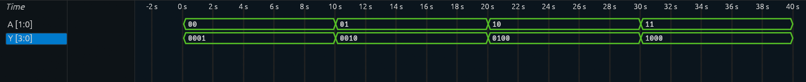

# 2-to-4 Decoder

A 2-to-4 decoder implemented in **Verilog RTL** and verified through simulation using **Icarus Verilog** and **Surfer Waveform Viewer**.

## Overview

A 2-to-4 decoder is a combinational logic circuit that converts a **2-bit binary input** into one of **four active outputs**.

```text
2-bit Input → 2-to-4 Decoder → 4-bit Output
```

For each input combination, exactly one output is active.

## Truth Table

| A[1:0] | Y[3:0] |
| :----: | :----: |
|  `00`  | `0001` |
|  `01`  | `0010` |
|  `10`  | `0100` |
|  `11`  | `1000` |

## Boolean Logic

```text
Y0 = ~A1 & ~A0
Y1 = ~A1 &  A0
Y2 =  A1 & ~A0
Y3 =  A1 &  A0
```

Each output is activated only for its corresponding input combination.

## RTL Implementation

```verilog
module decoder_2to4 (
    input  [1:0] A,
    output [3:0] Y
);

assign Y[0] = ~A[1] & ~A[0];
assign Y[1] = ~A[1] &  A[0];
assign Y[2] =  A[1] & ~A[0];
assign Y[3] =  A[1] &  A[0];

endmodule
```

## Simulation Waveform

The design was simulated using **Icarus Verilog** and the resulting waveform was analyzed using **Surfer Waveform Viewer**.

The waveform below verifies all four possible input combinations and their corresponding decoder outputs.



### Observed Output

```text
A = 00  →  Y = 0001
A = 01  →  Y = 0010
A = 10  →  Y = 0100
A = 11  →  Y = 1000
```

The waveform confirms the expected one-hot output for every possible input combination.

## Testbench

The testbench applies all possible 2-bit input combinations:

```text
00 → 01 → 10 → 11
```

and observes the corresponding outputs.

The simulation generates a VCD waveform file for analysis in Surfer.

## Project Structure

```text
2to4Decoder/
│
├── decoder_2to4.v
├── decoder_2to4_tb.v
├── README.md
├── .gitignore
│
└── assets/
    └── decoder_waveform.png
```

Generated simulation files such as `.vcd` files and compiled simulation executables are excluded using `.gitignore`.

## Tools Used

* **Verilog** — RTL design
* **Icarus Verilog** — simulation
* **Surfer** — waveform analysis
* **Git & GitHub** — version control and documentation

## Learning Outcomes

* Combinational logic design
* 2-to-4 decoder implementation
* Truth tables and Boolean expressions
* Verilog RTL
* Testbench development
* RTL simulation
* VCD waveform generation
* Waveform-based verification
* Git/GitHub project organization

## Next Project

**4-to-2 Encoder**

The next project will implement:

```text
4 Inputs → 4-to-2 Encoder → 2 Outputs
```
