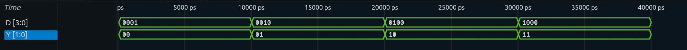

# 4-to-2 Encoder

A 4-to-2 encoder implemented in **Verilog RTL** and verified through
simulation using **Icarus Verilog** and **Surfer Waveform Viewer**.

## Overview

An encoder is a combinational logic circuit that converts information
from multiple input lines into a smaller binary-coded output.

A **4-to-2 encoder** has four input lines and two output lines:

    4-bit Input → 4-to-2 Encoder → 2-bit Output

The basic encoder assumes that **only one input is active (`1`) at a
time**.

The output represents the binary position of the active input.

For example:

    D = 0100

    D2 is active
    ↓
    Output = 10

## Block Diagram

    ┌─────────────────┐
    │                 │
    │   4-to-2        │
    │    Encoder      │
    │                 │
    └─────────────────┘
       ▲           │
       │           ▼
     D[3:0]      Y[1:0]

## Truth Table

   D3   D2   D1   D0   Y1   Y0
  ---- ---- ---- ---- ---- ----
   0    0    0    1    0    0
   0    0    1    0    0    1
   0    1    0    0    1    0
   1    0    0    0    1    1

### Input-to-Output Mapping

    D0 → 00
    D1 → 01
    D2 → 10
    D3 → 11

Only one input is assumed to be active at any given time.

## Boolean Logic

From the truth table, the output equations are:

    Y1 = D2 | D3
    Y0 = D1 | D3

### Y1

Y1 becomes `1` when either D2 or D3 is active.

    Y1 = D2 OR D3

### Y0

Y0 becomes `1` when either D1 or D3 is active.

    Y0 = D1 OR D3

Therefore:

    Y1 = D2 | D3
    Y0 = D1 | D3

## RTL Implementation

The encoder is implemented using continuous assignments in Verilog.

``` verilog
module encoder_4to2 (
    input  [3:0] D,
    output [1:0] Y
);

assign Y[1] = D[2] | D[3];
assign Y[0] = D[1] | D[3];

endmodule
```

The design is purely **combinational**, so no clock or sequential logic
is required.

## Testbench

The testbench applies all four valid one-hot input combinations:

    0001
    0010
    0100
    1000

For each input, the corresponding encoded output is observed.

Expected results:

    D = 0001 → Y = 00
    D = 0010 → Y = 01
    D = 0100 → Y = 10
    D = 1000 → Y = 11

The testbench also generates a VCD waveform file for visual
verification.

## Simulation

The design was simulated using **Icarus Verilog**.

The generated VCD file was opened and analyzed using **Surfer Waveform
Viewer**.

### Simulation Waveform



The waveform shows both:

-   `D[3:0]` --- 4-bit encoder input
-   `Y[1:0]` --- 2-bit encoded output

The observed transitions match the expected truth table:

    D[3:0]    Y[1:0]

    0001  →    00
    0010  →    01
    0100  →    10
    1000  →    11

This confirms that the RTL implementation produces the expected output
for every valid input condition.

## Verification

   Input    Expected Output   Simulated Output   Status
  -------- ----------------- ------------------ --------
   `0001`        `00`               `00`          PASS
   `0010`        `01`               `01`          PASS
   `0100`        `10`               `10`          PASS
   `1000`        `11`               `11`          PASS

All four valid input combinations produce the expected encoded output.

## Limitation of a Basic Encoder

A basic encoder assumes that **only one input is active at a time**.

For example, this is valid:

    D = 0100

But this is ambiguous:

    D = 0110

because both D2 and D1 are active simultaneously.

A basic encoder does not have a defined way to decide which input should
take priority.

This limitation leads to the next project:

**Priority Encoder**

A priority encoder assigns a priority to the inputs and produces a valid
output even when multiple inputs are active.

## Project Structure

    4to2Encoder/
    │
    ├── encoder_4to2.v
    ├── encoder_4to2_tb.v
    ├── README.md
    ├── .gitignore
    │
    └── assets/
        └── encoder_waveform.png

Generated simulation files such as `.vcd` files and compiled simulation
executables are excluded using `.gitignore`.

## Tools Used

-   **Verilog** --- RTL design
-   **Icarus Verilog** --- RTL simulation
-   **Surfer** --- waveform analysis
-   **Git & GitHub** --- version control and documentation

## Learning Outcomes

This project provided hands-on practice with:

-   Combinational logic design
-   Encoder design
-   Truth tables
-   Boolean expressions
-   Verilog RTL
-   Testbench development
-   RTL simulation
-   VCD waveform generation
-   Waveform-based verification
-   One-hot input representation
-   Git/GitHub project organization

## Next Project

### Priority Encoder

The next project will extend the basic 4-to-2 encoder to handle
**multiple active inputs** by assigning a priority to each input.

    4 Inputs → Priority Encoder → 2-bit Output + Valid Signal
