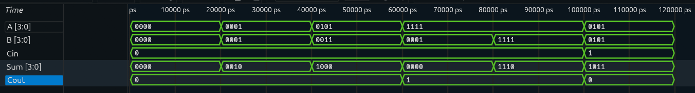

# 4-Bit Ripple Carry Adder

## Overview

A **4-Bit Ripple Carry Adder** is a combinational logic circuit that adds two 4-bit binary numbers.

The inputs are:

* `A[3:0]`
* `B[3:0]`
* `Cin` (Carry-In)

The outputs are:

* `Sum[3:0]`
* `Cout` (Carry-Out)

The design is constructed by connecting four Full Adders in series. The Carry-Out from each Full Adder is connected to the Carry-In of the next stage.

This sequential propagation of carry is known as **ripple carry**.

---

## Block Diagram

```text
        A[0], B[0]
             │
             ▼
Cin ─────▶ ┌─────┐
          │ FA0 │────▶ Sum[0]
          └──┬──┘
             │ C1
             ▼
        ┌──────────┐
A[1], B[1] ─▶│ FA1 │────▶ Sum[1]
             └──┬──┘
                │ C2
                ▼
        ┌──────────┐
A[2], B[2] ─▶│ FA2 │────▶ Sum[2]
             └──┬──┘
                │ C3
                ▼
        ┌──────────┐
A[3], B[3] ─▶│ FA3 │────▶ Sum[3]
             └──┬──┘
                │
                ▼
               Cout
```

---

## Input-to-Output Mapping

The 4-Bit Ripple Carry Adder performs the following operation:

```text
A + B + Cin = {Cout, Sum}
```

Where:

* `A` and `B` are 4-bit binary inputs.
* `Cin` is the input carry.
* `Sum` contains the 4-bit result.
* `Cout` represents the final carry generated from the most significant bit.

For example:

```text
A    = 0101  (5)
B    = 0011  (3)
Cin  = 0

Result = 1000  (8)

Sum  = 1000
Cout = 0
```

Another example involving Carry-Out:

```text
A    = 1111  (15)
B    = 0001  (1)
Cin  = 0

Result = 10000  (16)

Sum  = 0000
Cout = 1
```

---

## Architecture

The design consists of four Full Adders connected in series.

```text
FA0 → FA1 → FA2 → FA3
```

The carry propagates through each stage as follows:

```text
Cin → FA0 → C1 → FA1 → C2 → FA2 → C3 → FA3 → Cout
```

Each Full Adder performs the addition for one bit position.

---

## RTL Implementation

The 4-Bit Ripple Carry Adder is implemented using structural Verilog modeling.

Four instances of the Full Adder module are connected together:

```text
Full Adder 0 → Generates Sum[0] and C1
Full Adder 1 → Generates Sum[1] and C2
Full Adder 2 → Generates Sum[2] and C3
Full Adder 3 → Generates Sum[3] and Cout
```

This demonstrates **hierarchical RTL design**, where a previously designed Full Adder module is reused to construct a larger digital circuit.

---

## Testbench

The testbench applies different combinations of:

* `A[3:0]`
* `B[3:0]`
* `Cin`

The output is verified against the expected binary addition result.

Example test cases include:

```text
0000 + 0000
0001 + 0001
0101 + 0011
1111 + 0001
1111 + 1111
```

---

## Simulation

The simulation verifies that:

* Each Full Adder generates the correct Sum bit.
* Carry propagates correctly between stages.
* The final Carry-Out is generated correctly.
* The complete 4-bit addition produces the expected result.

### Simulation Waveform



---

## Verification

| A    | B    | Cin | Cout | Sum  |
| ---- | ---- | --- | ---- | ---- |
| 0000 | 0000 | 0   | 0    | 0000 |
| 0001 | 0001 | 0   | 0    | 0010 |
| 0101 | 0011 | 0   | 0    | 1000 |
| 1111 | 0001 | 0   | 1    | 0000 |
| 1111 | 1111 | 0   | 1    | 1110 |

All test cases were verified against:

```text
{Cout, Sum} = A + B + Cin
```

---

## Design Consideration

The Ripple Carry Adder architecture is simple and modular. However, the carry must propagate sequentially through each Full Adder stage.

As the number of bits increases, the propagation delay also increases because each stage may need to wait for the carry generated by the previous stage.

More advanced adder architectures, such as the **Carry Lookahead Adder**, reduce this delay by calculating carry signals more efficiently.

---

## Project Structure

```text
4-Bit-Ripple-Carry-Adder/
│
├── rtl/
│   ├── full_adder.v
│   └── ripple_carry_adder_4bit.v
│
├── tb/
│   └── ripple_carry_adder_4bit_tb.v
│
├── simulation/
│   └── waveform.png
│
└── README.md
```

---

## Tools Used

* Verilog HDL
* Icarus Verilog
* GTKWave

---

## Learning Outcomes

Through this project, I learned:

* Multi-bit binary addition
* Carry propagation
* Ripple Carry Adder architecture
* Structural Verilog modeling
* Module instantiation
* Hierarchical RTL design
* Reusing smaller modules to build larger digital systems
* Testbench-based functional verification

---

## Next Project

➡️ **Comparator**

The next project focuses on comparing binary values using combinational logic.
