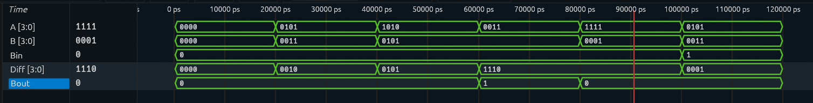

# 4-Bit Subtractor

## Overview

This project implements a **4-Bit Binary Subtractor** in Verilog. It subtracts two 4-bit binary numbers and supports a Borrow-In input.

The circuit performs:

```text
A - B - Bin
```

where:

- `A[3:0]` — Minuend
- `B[3:0]` — Subtrahend
- `Bin` — Borrow-In
- `Diff[3:0]` — Difference
- `Bout` — Borrow-Out

---

## Block Diagram

```text
              ┌──────────────────────┐
A[3:0] ──────▶│                      │────▶ Diff[3:0]
B[3:0] ──────▶│   4-Bit Subtractor   │
Bin ─────────▶│                      │────▶ Bout
              └──────────────────────┘
```

---

## Input-to-Output Mapping

```text
Diff = A - B - Bin
Bout = (A < B + Bin)
```

---

## RTL Implementation

```verilog
assign Diff = A - B - Bin;
assign Bout = (A < B + Bin);
```

---

## Testbench

The testbench verifies basic subtraction, Borrow-In functionality, and Borrow-Out generation using representative test cases.

| Test Case | A | B | Bin | Operation |
|---|---:|---:|---:|---|
| 1 | 0 | 0 | 0 | 0 - 0 = 0 |
| 2 | 5 | 3 | 0 | 5 - 3 = 2 |
| 3 | 10 | 5 | 0 | 10 - 5 = 5 |
| 4 | 3 | 5 | 0 | Borrow required |
| 5 | 15 | 1 | 0 | 15 - 1 = 14 |
| 6 | 5 | 3 | 1 | 5 - 3 - 1 = 1 |

---

## Simulation

The simulation verifies:

- Correct 4-bit binary subtraction
- Correct Difference output
- Correct Borrow-Out generation
- Subtraction with Borrow-In

### Simulation Waveform



---

## Verification

| A | B | Bin | Diff | Bout |
|---:|---:|---:|---:|---:|
| 0 | 0 | 0 | 0 | 0 |
| 5 | 3 | 0 | 2 | 0 |
| 10 | 5 | 0 | 5 | 0 |
| 3 | 5 | 0 | 14 | 1 |
| 15 | 1 | 0 | 14 | 0 |
| 5 | 3 | 1 | 1 | 0 |

For `3 - 5`, the 4-bit Difference is `1110`, while `Bout` indicates that a borrow occurred.

---

## Design Consideration

The Difference output is limited to 4 bits. When the subtraction result is negative, the output wraps around in 4-bit binary representation, while `Bout` indicates that a borrow was required.

---

## Project Structure

```text
4-Bit-Subtractor/
│
├── subtractor4bit.v
├── subtractor4bit_tb.v
├── waveform.png
└── README.md
```

---

## Tools Used

- Verilog HDL
- Icarus Verilog
- GTKWave

---

## Learning Outcomes

Through this project, I learned:

- 4-bit binary subtraction
- Borrow-In and Borrow-Out
- Vector inputs and outputs in Verilog
- Continuous assignment using `assign`
- Arithmetic and comparison operators
- Testbench development
- Waveform-based verification

---

## Next Project

➡️ **Encoder**
