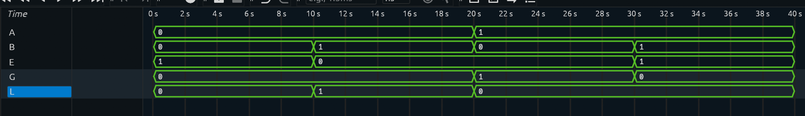

# 1-Bit Comparator

## Overview

A 1-bit Comparator designed and verified using Verilog HDL.

The comparator compares two 1-bit binary inputs, `A` and `B`, and produces three outputs indicating whether `A` is greater than, equal to, or less than `B`.

The three comparison conditions are:

```text
G = A > B
E = A = B
L = A < B
```

For every input combination, exactly one comparison output is HIGH.

## Block Diagram

```text
             ┌─────────────────┐
A ──────────▶│                 │─── G (A > B)
             │  1-BIT          │─── E (A = B)
B ──────────▶│  COMPARATOR     │─── L (A < B)
             │                 │
             └─────────────────┘
```

## Truth Table

| A | B | G (A > B) | E (A = B) | L (A < B) |
|---|---|-----------|-----------|-----------|
| 0 | 0 | 0 | 1 | 0 |
| 0 | 1 | 0 | 0 | 1 |
| 1 | 0 | 1 | 0 | 0 |
| 1 | 1 | 0 | 1 | 0 |

### Input-to-Output Mapping

| A | B | Active Output | Comparison |
|---|---|---------------|------------|
| 0 | 0 | E | A = B |
| 0 | 1 | L | A < B |
| 1 | 0 | G | A > B |
| 1 | 1 | E | A = B |

## Boolean Logic

### G

`G` is HIGH only when `A = 1` and `B = 0`.

```text
G = A · B'
```

Verilog form:

```text
G = A & ~B
```

### E

`E` is HIGH when both inputs are equal: `00` or `11`.

```text
E = A'B' + AB
```

This is the XNOR function.

Verilog form:

```text
E = (~A & ~B) | (A & B)
```

### L

`L` is HIGH only when `A = 0` and `B = 1`.

```text
L = A'B
```

Verilog form:

```text
L = ~A & B
```

## RTL Implementation

The design is implemented using continuous assignments in Verilog HDL.

```verilog
module Comparator_1bit (

    input A,
    input B,

    output G,
    output E,
    output L

);

assign G = A & ~B;

assign E = (~A & ~B) | (A & B);

assign L = ~A & B;

endmodule
```

## Testbench

The testbench covers all four possible combinations of the two 1-bit inputs.

```verilog
`timescale 1ns/1ps

module Comparator_1bit_tb;

reg A;
reg B;
wire G;
wire E;
wire L;

Comparator_1bit uut(
    .A(A),
    .B(B),
    .G(G),
    .E(E),
    .L(L)
);

initial begin

    $dumpfile("Comparator_1bit.vcd");
    $dumpvars(0, Comparator_1bit_tb);

    // Testing
    A = 1'b0; B = 1'b0; #10;
    A = 1'b0; B = 1'b1; #10;
    A = 1'b1; B = 1'b0; #10;
    A = 1'b1; B = 1'b1; #10;

    $finish;

end

endmodule
```

## Simulation

The RTL was simulated using Icarus Verilog and the generated VCD waveform was analyzed using Surfer.

### Simulation Waveform



## Verification

The simulation waveform was checked against the expected truth table.

| A | B | Expected G | Expected E | Expected L | Observed |
|---|---|------------|------------|------------|----------|
| 0 | 0 | 0 | 1 | 0 | 010 |
| 0 | 1 | 0 | 0 | 1 | 001 |
| 1 | 0 | 1 | 0 | 0 | 100 |
| 1 | 1 | 0 | 1 | 0 | 010 |

All four possible input combinations produced the expected outputs.

The comparison outputs are mutually exclusive, with exactly one output HIGH for each input combination.

## Limitation of a 1-Bit Comparator

This implementation compares only two 1-bit values.

For multi-bit binary numbers, additional comparison logic is required to compare the bits from the most significant position toward the least significant position.

## Project Structure

```text
Comparator_1bit/
│
├── Comparator_1bit.v
├── Comparator_1bit_tb.v
├── Comparator_1bit.vcd
├── Comparator_waveform.png
└── README.md
```

## Tools Used

- Verilog HDL
- Icarus Verilog — RTL simulation
- Surfer — waveform analysis

## Learning Outcomes

This project helped reinforce:

- Binary comparison
- Greater-than, equal-to, and less-than logic
- XNOR-based equality detection
- Boolean expression derivation
- Combinational logic design
- Verilog continuous assignments
- Testbench development
- VCD waveform generation
- RTL simulation and functional verification

## Next Project

**Half Adder**

The next project will introduce binary addition at the 1-bit level before progressing to full adders and multi-bit arithmetic circuits.
