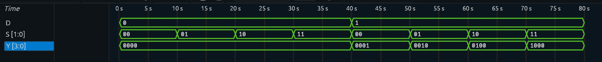

# 1:4 Demultiplexer

## Overview

A 1:4 Demultiplexer designed and verified using Verilog HDL.

A demultiplexer routes a single data input to one of multiple outputs based on the select lines. In this design, two select lines control which of the four outputs receives the input signal.

The select mapping is:

```text
S1S0 = 00 → Y0
S1S0 = 01 → Y1
S1S0 = 10 → Y2
S1S0 = 11 → Y3
```

## Block Diagram

```text
                    ┌─────────────┐
                    │             │─── Y0
                    │             │─── Y1
D ─────────────────▶│   1 : 4     │─── Y2
                    │   DEMUX     │─── Y3
S1 ────────────────▶│             │
S0 ────────────────▶│             │
                    └─────────────┘
```

## Truth Table

| S1 | S0 | Y0 | Y1 | Y2 | Y3 |
|----|----|----|----|----|----|
| 0  | 0  | D  | 0  | 0  | 0  |
| 0  | 1  | 0  | D  | 0  | 0  |
| 1  | 0  | 0  | 0  | D  | 0  |
| 1  | 1  | 0  | 0  | 0  | D  |

### Input-to-Output Mapping

| Select (`S1S0`) | Selected Output |
|------------------|-----------------|
| `00` | Y0 |
| `01` | Y1 |
| `10` | Y2 |
| `11` | Y3 |

Only the selected output follows the input `D`. All other outputs remain LOW.

## Boolean Logic

### Y0

Y0 is selected when `S1S0 = 00`.

```text
Y0 = D · S1' · S0'
```

### Y1

Y1 is selected when `S1S0 = 01`.

```text
Y1 = D · S1' · S0
```

### Y2

Y2 is selected when `S1S0 = 10`.

```text
Y2 = D · S1 · S0'
```

### Y3

Y3 is selected when `S1S0 = 11`.

```text
Y3 = D · S1 · S0
```

## RTL Implementation

The design is implemented using continuous assignments in Verilog HDL.

```verilog
module Demux_1to4(

    input D,

    input [1:0] S,

    output [3:0] Y

);

assign Y[0] = D & ~S[1] & ~S[0];

assign Y[1] = D & ~S[1] & S[0];

assign Y[2] = D & S[1] & ~S[0];

assign Y[3] = D & S[1] & S[0];

endmodule
```

## Testbench

The testbench verifies both possible input states (`D = 0` and `D = 1`) across all four select-line combinations.

```verilog
module Demux_1to4_tb;

reg D;
reg [1:0] S;
wire [3:0] Y;

Demux_1to4 uut (
    .D(D),
    .S(S),
    .Y(Y)
);

initial begin

    $dumpfile("Demux_1to4.vcd");
    $dumpvars(0, Demux_1to4_tb);

    // Testing

    D = 1'b0; S = 2'b00; #10;
    D = 1'b0; S = 2'b01; #10;
    D = 1'b0; S = 2'b10; #10;
    D = 1'b0; S = 2'b11; #10;

    D = 1'b1; S = 2'b00; #10;
    D = 1'b1; S = 2'b01; #10;
    D = 1'b1; S = 2'b10; #10;
    D = 1'b1; S = 2'b11; #10;

    $finish;

end

endmodule
```

## Simulation

The RTL was simulated using Icarus Verilog and the generated VCD waveform was analyzed using Surfer.

### Simulation Waveform



## Verification

The simulation confirms that the input signal is routed to the correct output according to the select lines.

| D | S | Expected Y | Observed |
|---|---|-------------|----------|
| 0 | `00` | `0000` | `0000` |
| 0 | `01` | `0000` | `0000` |
| 0 | `10` | `0000` | `0000` |
| 0 | `11` | `0000` | `0000` |
| 1 | `00` | `0001` | `0001` |
| 1 | `01` | `0010` | `0010` |
| 1 | `10` | `0100` | `0100` |
| 1 | `11` | `1000` | `1000` |

All tested cases produced the expected output.

## Limitation of a Basic Demultiplexer

This implementation is a purely combinational 1:4 demultiplexer. It does not include an enable input, so routing is always active based on the select lines.

It also does not provide additional control or error-handling logic beyond the basic demultiplexing function.

## Project Structure

```text
Demux_1to4/
│
├── Demux_1to4.v
├── Demux_1to4_tb.v
├── Demux_1to4.vcd
├── Demux_waveform.png
└── README.md
```

## Tools Used

- Verilog HDL
- Icarus Verilog — RTL simulation
- Surfer — waveform analysis

## Learning Outcomes

This project helped reinforce:

- Demultiplexer operation
- Select-line based data routing
- Boolean expression derivation
- Combinational logic design
- Verilog continuous assignments
- Testbench development
- VCD waveform generation
- RTL simulation and functional verification

## Next Project

**Comparator**

The next project will continue the progression through fundamental combinational digital logic and Verilog RTL design.
