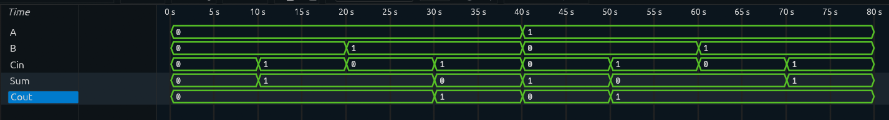

# Full Adder

## Overview

A **Full Adder** is a combinational logic circuit that adds three single-bit binary inputs.

The inputs are:

* `A`
* `B`
* `Cin` (Carry-In)

The outputs are:

* `Sum`
* `Cout` (Carry-Out)

Unlike a Half Adder, a Full Adder can process a Carry-In signal. This makes it possible to connect multiple Full Adders together to perform multi-bit binary addition.

---

## Block Diagram

```text
              ┌─────────────┐
A ───────────▶│             │────▶ Sum
B ───────────▶│ Full Adder  │
Cin ─────────▶│             │────▶ Cout
              └─────────────┘
```

---

## Truth Table

| A | B | Cin | Sum | Cout |
| - | - | --- | --- | ---- |
| 0 | 0 | 0   | 0   | 0    |
| 0 | 0 | 1   | 1   | 0    |
| 0 | 1 | 0   | 1   | 0    |
| 0 | 1 | 1   | 0   | 1    |
| 1 | 0 | 0   | 1   | 0    |
| 1 | 0 | 1   | 0   | 1    |
| 1 | 1 | 0   | 0   | 1    |
| 1 | 1 | 1   | 1   | 1    |

---

## Input-to-Output Mapping

The Full Adder performs the following operation:

```text
A + B + Cin
```

The least significant bit of the result becomes `Sum`, while the carry generated becomes `Cout`.

For example:

```text
1 + 1 + 0 = 10

Sum  = 0
Cout = 1
```

---

## Boolean Logic

### Sum

The Sum output is HIGH when an odd number of inputs are HIGH.

```text
Sum = A ⊕ B ⊕ Cin
```

### Carry-Out

The Carry-Out is HIGH when at least two of the three inputs are HIGH.

```text
Cout = AB + ACin + BCin
```

---

## RTL Implementation

The Full Adder is implemented using combinational logic in Verilog.

```verilog
assign sum  = A ^ B ^ Cin;
assign cout = (A & B) | (A & Cin) | (B & Cin);
```

---

## Testbench

The testbench applies all possible combinations of the three input signals.

Since there are three inputs:

```text
2³ = 8 combinations
```

All possible input combinations are tested.

---

## Simulation

The simulation verifies that:

* The Sum output follows the expected XOR logic.
* Carry-Out is generated when at least two inputs are HIGH.
* All eight input combinations produce the expected outputs.

### Simulation Waveform



---

## Verification

| Input Operation | Sum | Cout |
| --------------- | --- | ---- |
| `0 + 0 + 0`     | 0   | 0    |
| `0 + 1 + 0`     | 1   | 0    |
| `1 + 1 + 0`     | 0   | 1    |
| `1 + 1 + 1`     | 1   | 1    |

All test cases were verified successfully.

---

## Design Consideration

A Full Adder can be used as a building block for multi-bit binary addition.

The `Cout` of one Full Adder can be connected to the `Cin` of the next Full Adder, allowing carries to propagate between bit positions.

This concept is used to build a **4-Bit Ripple Carry Adder**.

---

## Project Structure

```text
Full-Adder/
│
├── rtl/
│   └── full_adder.v
│
├── tb/
│   └── full_adder_tb.v
│
├── simulation/
│   └── waveform.png
│
└── README.md
```

---

## Tools Used

* Verilog HDL
* Icarus Verilog
* GTKWave

---

## Learning Outcomes

Through this project, I learned:

* Binary addition with Carry-In and Carry-Out
* Combinational logic design
* Boolean logic implementation
* Verilog RTL development
* Testbench development
* Exhaustive functional verification
* Using Full Adders as building blocks for multi-bit adders

---

## Next Project

➡️ **4-Bit Ripple Carry Adder**

The next project connects multiple Full Adders to perform addition on two 4-bit binary numbers.
