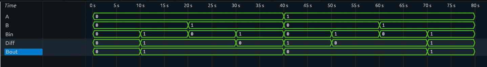

# Full Subtractor

## Overview

A **Full Subtractor** is a combinational logic circuit that subtracts two single-bit binary values while accounting for a Borrow-In from a previous bit position.

The inputs are:

- `A` — Minuend
- `B` — Subtrahend
- `Bin` — Borrow-In

The outputs are:

- `Diff` — Difference
- `Bout` — Borrow-Out

Unlike a Half Subtractor, a Full Subtractor can process a Borrow-In signal, making it suitable for constructing multi-bit binary subtractors.

---

## Block Diagram

```text
              ┌─────────────────┐
A ───────────▶│                 │────▶ Diff
B ───────────▶│ Full Subtractor │
Bin ─────────▶│                 │────▶ Bout
              └─────────────────┘
```

---

## Truth Table

| A | B | Bin | Diff | Bout |
|---|---|-----|------|------|
| 0 | 0 | 0 | 0 | 0 |
| 0 | 0 | 1 | 1 | 1 |
| 0 | 1 | 0 | 1 | 1 |
| 0 | 1 | 1 | 0 | 1 |
| 1 | 0 | 0 | 1 | 0 |
| 1 | 0 | 1 | 0 | 0 |
| 1 | 1 | 0 | 0 | 0 |
| 1 | 1 | 1 | 1 | 1 |

---

## Input-to-Output Mapping

The Full Subtractor performs:

```text
A - B - Bin
```

For example:

```text
1 - 0 - 0 = 1

Diff = 1
Bout = 0
```

Another example:

```text
0 - 0 - 1

Diff = 1
Bout = 1
```

---

## Boolean Logic

### Difference

```text
Diff = A ⊕ B ⊕ Bin
```

### Borrow-Out

```text
Bout = A'B + A'Bin + BBin
```

---

## RTL Implementation

```verilog
assign Diff = A ^ B ^ Bin;
assign Bout = (~A & B) | (~A & Bin) | (B & Bin);
```

---

## Testbench

The testbench applies all possible combinations of the three input signals.

Since there are three inputs:

```text
2³ = 8 combinations
```

All eight possible input combinations are tested using a loop.

---

## Simulation

The simulation verifies that:

- The Difference output follows the expected XOR logic.
- Borrow-Out is generated correctly.
- All eight possible input combinations produce the expected outputs.

### Simulation Waveform



---

## Verification

| Input Operation | Diff | Bout |
|-----------------|------|------|
| `0 - 0 - 0` | 0 | 0 |
| `0 - 0 - 1` | 1 | 1 |
| `0 - 1 - 0` | 1 | 1 |
| `0 - 1 - 1` | 0 | 1 |
| `1 - 0 - 0` | 1 | 0 |
| `1 - 0 - 1` | 0 | 0 |
| `1 - 1 - 0` | 0 | 0 |
| `1 - 1 - 1` | 1 | 1 |

All possible input combinations were verified successfully.

---

## Design Consideration

A Full Subtractor can be used as a building block for multi-bit binary subtraction.

The `Bout` of one Full Subtractor can be connected to the `Bin` of the next Full Subtractor, allowing borrows to propagate between bit positions.

This concept is used to build a **4-Bit Ripple Borrow Subtractor**.

---

## Project Structure

```text
Full-Subtractor/
│
├── fullsub.v
├── fullsub_tb.v
├── waveform.png
├── README.md
└── LICENSE
```

---

## Tools Used

- Verilog HDL
- Icarus Verilog
- GTKWave

---

## Learning Outcomes

Through this project, I learned:

- Binary subtraction with Borrow-In and Borrow-Out
- Combinational logic design
- Boolean logic implementation
- Verilog RTL development
- Testbench development
- Exhaustive functional verification
- Using Full Subtractors as building blocks for multi-bit subtractors

---

## Next Project

➡️ **4-Bit Ripple Borrow Subtractor**

The next project connects multiple Full Subtractors to perform subtraction on two 4-bit binary numbers.
