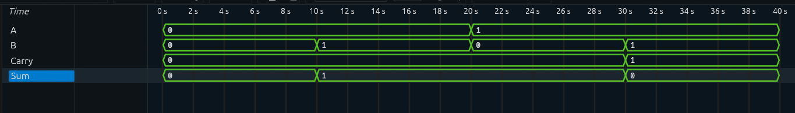

# Half Adder

## Overview

A **Half Adder** is a combinational logic circuit that adds two single-bit binary inputs.

It takes two inputs:

* `A`
* `B`

And produces two outputs:

* `Sum`
* `Carry`

A Half Adder does not have a Carry-In input, making it suitable for basic single-bit binary addition.

---

## Block Diagram

```text
        ┌─────────────┐
A ─────▶│             │────▶ Sum
        │ Half Adder  │
B ─────▶│             │────▶ Carry
        └─────────────┘
```

---

## Truth Table

| A | B | Sum | Carry |
| - | - | --- | ----- |
| 0 | 0 | 0   | 0     |
| 0 | 1 | 1   | 0     |
| 1 | 0 | 1   | 0     |
| 1 | 1 | 0   | 1     |

---

## Boolean Logic

### Sum

The Sum output is HIGH when the inputs are different.

```text
Sum = A ⊕ B
```

### Carry

The Carry output is HIGH when both inputs are HIGH.

```text
Carry = A · B
```

---

## RTL Implementation

The Half Adder is implemented using combinational logic in Verilog.

```verilog
assign sum   = A ^ B;
assign carry = A & B;
```

---

## Testbench

The testbench applies all possible input combinations to verify the functionality of the Half Adder.

Since there are two inputs:

```text
2² = 4 combinations
```

All possible combinations are tested.

---

## Simulation

The simulation verifies that:

* The Sum output follows XOR logic.
* The Carry output follows AND logic.
* All possible input combinations produce the expected outputs.

### Simulation Waveform



---

## Verification

| Input      | Expected Output  |
| ---------- | ---------------- |
| `A=0, B=0` | `Sum=0, Carry=0` |
| `A=0, B=1` | `Sum=1, Carry=0` |
| `A=1, B=0` | `Sum=1, Carry=0` |
| `A=1, B=1` | `Sum=0, Carry=1` |

All test cases were verified successfully.

---

## Limitation

A Half Adder cannot process a **Carry-In** signal.

Because of this limitation, it cannot independently perform addition at higher bit positions in a multi-bit binary addition operation.

This limitation is addressed by the **Full Adder**.

---

## Project Structure

```text
Half-Adder/
│
├── rtl/
│   └── half_adder.v
│
├── tb/
│   └── half_adder_tb.v
│
├── simulation/
│   └── waveform.png
│
└── README.md
```

---

## Tools Used

* Verilog HDL
* Icarus Verilog
* GTKWave

---

## Learning Outcomes

Through this project, I learned:

* Binary addition fundamentals
* Combinational logic design
* XOR and AND gate behavior
* Basic Verilog RTL design
* Testbench development
* Functional verification

---

## Next Project

➡️ **Full Adder**

The Full Adder extends the Half Adder by introducing a **Carry-In** input.
