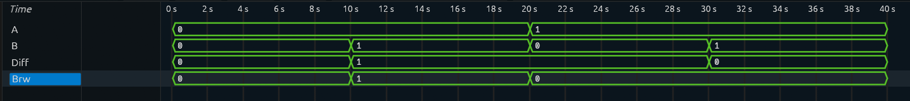

# Half Subtractor

## Overview

A **Half Subtractor** is a combinational logic circuit that subtracts one single-bit binary input from another.

It takes two inputs:

- `A` — Minuend
- `B` — Subtrahend

And produces two outputs:

- `Diff` — Difference
- `Brw` — Borrow

A Half Subtractor does not have a Borrow-In input, making it suitable for basic single-bit binary subtraction.

---

## Block Diagram

```text
        ┌─────────────────┐
A ─────▶│                 │────▶ Diff
        │ Half Subtractor │
B ─────▶│                 │────▶ Brw
        └─────────────────┘
```

---

## Truth Table

| A | B | Diff | Brw |
|---|---|------|-----|
| 0 | 0 | 0 | 0 |
| 0 | 1 | 1 | 1 |
| 1 | 0 | 1 | 0 |
| 1 | 1 | 0 | 0 |

---

## Input-to-Output Mapping

The Half Subtractor performs the following operation:

```text
A - B
```

For example:

```text
1 - 0 = 1

Diff = 1
Brw  = 0
```

When `A = 0` and `B = 1`, a borrow is required:

```text
0 - 1

Diff = 1
Brw  = 1
```

---

## Boolean Logic

### Difference

The Difference output is HIGH when the inputs are different.

```text
Diff = A ⊕ B
```

### Borrow

A Borrow is generated when `A` is LOW and `B` is HIGH.

```text
Brw = A' · B
```

---

## RTL Implementation

The Half Subtractor is implemented using combinational logic in Verilog.

```verilog
assign Diff = A ^ B;
assign Brw  = ~A & B;
```

---

## Testbench

The testbench applies all possible input combinations to verify the functionality of the Half Subtractor.

Since there are two inputs:

```text
2² = 4 combinations
```

All possible input combinations are tested.

---

## Simulation

The simulation verifies that:

- The Difference output follows XOR logic.
- A Borrow is generated when `A = 0` and `B = 1`.
- All possible input combinations produce the expected outputs.

### Simulation Waveform



---

## Verification

| Input Operation | Diff | Brw |
|-----------------|------|-----|
| `0 - 0` | 0 | 0 |
| `0 - 1` | 1 | 1 |
| `1 - 0` | 1 | 0 |
| `1 - 1` | 0 | 0 |

All possible input combinations were verified successfully.

---

## Limitation

A Half Subtractor cannot process a **Borrow-In** signal.

Because of this limitation, it cannot independently perform subtraction at higher bit positions in a multi-bit binary subtraction operation.

This limitation is addressed by the **Full Subtractor**.

---

## Project Structure

```text
Half-Subtractor/
│
├── rtl/
│   └── halfsub.v
│
├── tb/
│   └── halfsub_tb.v
│
├── simulation/
│   └── waveform.png
│
└── README.md
```

---

## Tools Used

- Verilog HDL
- Icarus Verilog
- GTKWave

---

## Learning Outcomes

Through this project, I learned:

- Binary subtraction fundamentals
- Difference and Borrow generation
- Combinational logic design
- XOR and NOT gate behavior
- Basic Verilog RTL design
- Testbench development
- Exhaustive functional verification

---

## Next Project

➡️ **Full Subtractor**

The Full Subtractor extends the Half Subtractor by introducing a **Borrow-In** input.