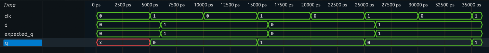

# D Flip-Flop

## Overview

A D Flip-Flop designed and verified using Verilog HDL.

The D Flip-Flop is a sequential logic element that stores one bit of data. The output `Q` captures the value of input `D` on the rising edge of the clock and holds that value until the next rising edge.

The basic operation is:

```text
Q(next) = D
```

The output changes only when a rising clock edge occurs.

## Block Diagram

```text
                 ┌─────────────────┐
D ──────────────▶│                 │─────▶ Q
                 │   D FLIP-FLOP   │
CLK ────────────▶│                 │
                 └─────────────────┘
```

## Truth Table

| Clock Edge | D | Q(next) |
|---|---|---|
| ↑ | 0 | 0 |
| ↑ | 1 | 1 |

### Input-to-Output Mapping

| D | Clock Edge | Q(next) | Operation |
|---|---|---|---|
| 0 | ↑ | 0 | Store 0 |
| 1 | ↑ | 1 | Store 1 |

Between clock edges, the output remains unchanged.

## Characteristic Equation

The characteristic equation of a D Flip-Flop is:

```text
Q(next) = D
```

At every rising edge of the clock, the next state of `Q` becomes equal to the input `D`.

## RTL Implementation

The design is implemented using a positive-edge triggered sequential `always` block in Verilog HDL.

```verilog
module d_flip_flop (
    input clk,
    input d,
    output reg q
);

always @(posedge clk) begin
    q <= d;
end

endmodule
```

The `posedge clk` ensures that the flip-flop responds only to the rising edge of the clock. The non-blocking assignment `<=` is used for sequential logic. citeturn0search3turn0search15

## Testbench

The testbench uses a generated clock and four directed test cases. Each test applies a value to `d`, sets the corresponding `expected_q`, waits for the next rising edge of the clock, and then checks the actual output `q`.

A `#1` delay inside the `check_output` task allows the flip-flop output to update before the comparison.

```verilog
`timescale 1ns/1ps

module d_flip_flop_tb;

    reg clk;
    reg d;

    wire q;

    reg expected_q;

    // Instantiate DUT
    d_flip_flop uut (
        .clk(clk),
        .d(d),
        .q(q)
    );

    // Clock generation
    always #5 clk = ~clk;

    // Generate waveform
    initial begin
        $dumpfile("waveform.vcd");
        $dumpvars(0, d_flip_flop_tb);
    end

    // Self-checking task
    task check_output;

        begin
            #1;

            if (q !== expected_q)
                $display("FAIL: Expected=%b | Actual=%b",
                         expected_q, q);
            else
                $display("PASS: Expected=%b | Actual=%b",
                         expected_q, q);
        end

    endtask

    // Test sequence
    initial begin

        clk = 0;
        d = 0;
        expected_q = 0;

        // Test 1
        d = 0;
        expected_q = 0;

        @(posedge clk);
        check_output;

        // Test 2
        d = 1;
        expected_q = 1;

        @(posedge clk);
        check_output;

        // Test 3
        d = 0;
        expected_q = 0;

        @(posedge clk);
        check_output;

        // Test 4
        d = 1;
        expected_q = 1;

        @(posedge clk);
        check_output;

        $display("--------------------------------");
        $display("D FLIP-FLOP TEST COMPLETE");
        $display("--------------------------------");

        $finish;

    end

endmodule
```

## Simulation

The RTL was simulated using Icarus Verilog and the generated VCD waveform was analyzed using GTKWave.

### Simulation Waveform



The waveform shows the clock, input `d`, expected output `expected_q`, and actual output `q`.

The output initially appears as `X` because the flip-flop has no reset or initial value. After the first rising clock edge, `q` captures `d` and subsequently follows the expected sequence.

## Verification

The testbench verifies four directed test cases.

| Test | D | Rising Clock Edge | Expected Q | Observed Q | Result |
|---|---:|---:|---:|---:|---|
| 1 | 0 | 1st | 0 | 0 | PASS |
| 2 | 1 | 2nd | 1 | 1 | PASS |
| 3 | 0 | 3rd | 0 | 0 | PASS |
| 4 | 1 | 4th | 1 | 1 | PASS |

All four test cases produced the expected output.

The waveform confirms that `q` changes on the rising edge of `clk` and retains its value between clock edges.

## Project Structure

```text
D_FlipFlop/
│
├── d_flip_flop.v
├── d_flip_flop_tb.v
├── waveform.vcd
├── waveform.png
└── README.md
```

## Tools Used

- Verilog HDL
- Icarus Verilog — RTL simulation
- GTKWave — waveform analysis

## Learning Outcomes

This project helped reinforce:

- Sequential logic design
- D Flip-Flop operation
- Positive-edge triggered logic
- Clock-controlled data storage
- Non-blocking assignments
- Verilog `always` blocks
- Self-checking testbench development
- VCD waveform generation
- RTL simulation and functional verification

## Next Project

**JK Flip-Flop**

The next project will introduce the JK Flip-Flop and extend the understanding of clocked sequential logic and state storage.