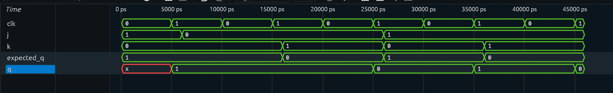

# JK Flip-Flop

## Overview

A JK Flip-Flop designed and verified using Verilog HDL.

The JK Flip-Flop is a sequential logic element that stores one bit of data. Its next state depends on the values of inputs `J` and `K` at the rising edge of the clock.

The four operating modes are:

```text
J = 0, K = 0 → Hold
J = 0, K = 1 → Reset
J = 1, K = 0 → Set
J = 1, K = 1 → Toggle
```

## Block Diagram

```text
                 ┌─────────────────┐
J ──────────────▶│                 │─────▶ Q
                 │   JK FLIP-FLOP  │
K ──────────────▶│                 │
                 │                 │
CLK ────────────▶│                 │
                 └─────────────────┘
```

## Truth Table

| Clock Edge | J | K | Q(next) | Operation |
|---|---|---|---|---|
| ↑ | 0 | 0 | Q | Hold |
| ↑ | 0 | 1 | 0 | Reset |
| ↑ | 1 | 0 | 1 | Set |
| ↑ | 1 | 1 | Q̅ | Toggle |

### Input-to-Output Mapping

| J | K | Q(next) | Operation |
|---|---|---|---|
| 0 | 0 | Q | Hold previous state |
| 0 | 1 | 0 | Reset |
| 1 | 0 | 1 | Set |
| 1 | 1 | Q̅ | Toggle previous state |

The output changes only on the rising edge of the clock.

## Characteristic Equation

The characteristic equation of a JK Flip-Flop is:

```text
Q(next) = JQ̅ + K̅Q
```

The equation represents the four operating modes of the JK Flip-Flop.

## RTL Implementation

The design is implemented using a positive-edge triggered sequential `always` block and a `case` statement in Verilog HDL.

```verilog
module jk_flipflop (
    input clk,
    input j,
    input k,
    output reg q
);

always @(posedge clk) begin
    case ({j, k})
        2'b00: q <= q;      // Hold
        2'b01: q <= 1'b0;   // Reset
        2'b10: q <= 1'b1;   // Set
        2'b11: q <= ~q;     // Toggle
    endcase
end

endmodule
```

The `posedge clk` ensures that the flip-flop responds only to the rising edge of the clock.

## Testbench

The testbench verifies all four operating modes of the JK Flip-Flop.

Because the flip-flop does not have a reset input, the test sequence first establishes a known state using the Set operation.

The test sequence is:

```text
10 → Set
00 → Hold
01 → Reset
10 → Set
11 → Toggle
```

A self-checking task compares the actual output `q` against the expected value `expected_q`.

```verilog
`timescale 1ns/1ps

module jk_flipflop_tb;

reg j;
reg k;
reg clk;
wire q;
reg expected_q;

jk_flipflop uut(
    .clk(clk),
    .j(j),
    .k(k),
    .q(q)
);

// Clock generation
always #5 clk = ~clk;

// Generate waveform
initial begin
    $dumpfile("waveform.vcd");
    $dumpvars(0,jk_flipflop_tb);
end

// Self Checking Task
task check_output;

    begin
        #1;

        if(q !== expected_q)
            $display("FAIL: Expected=%b | Actual=%b",
                     expected_q,q);
        else
            $display("PASS: Expected=%b | Actual=%b",
                     expected_q,q);
    end

endtask

// Test Sequence
initial begin

    clk = 0;
    j = 0;
    k = 0;
    expected_q = 0;

    // Test 1: Set
    j = 1;
    k = 0;
    expected_q = 1;

    @(posedge clk);
    check_output;

    // Test 2: Hold
    j = 0;
    k = 0;
    expected_q = 1;

    @(posedge clk);
    check_output;

    // Test 3: Reset
    j = 0;
    k = 1;
    expected_q = 0;

    @(posedge clk);
    check_output;

    // Test 4: Set
    j = 1;
    k = 0;
    expected_q = 1;

    @(posedge clk);
    check_output;

    // Test 5: Toggle
    j = 1;
    k = 1;
    expected_q = 0;

    @(posedge clk);
    check_output;

    $display("--------------------------------------");
    $display("JK FLIP-FLOP TEST COMPLETE");
    $display("--------------------------------------");

    $finish;

end

endmodule
```

## Simulation

The RTL was simulated using Icarus Verilog and the generated VCD waveform was analyzed using GTKWave.

### Simulation Waveform



The simulation sequence is:

```text
Initial Q = X

Test 1: 10 → Q = 1  (Set)
Test 2: 00 → Q = 1  (Hold)
Test 3: 01 → Q = 0  (Reset)
Test 4: 10 → Q = 1  (Set)
Test 5: 11 → Q = 0  (Toggle)
```

The initial `X` state is expected because the flip-flop has no reset or initial value. The first Set operation establishes a known state.

## Verification

The five directed test cases verify all four JK operating modes.

| Test | J | K | Previous Q | Expected Q | Observed Q | Result |
|---|---:|---:|---:|---:|---:|---|
| 1 | 1 | 0 | X | 1 | 1 | PASS |
| 2 | 0 | 0 | 1 | 1 | 1 | PASS |
| 3 | 0 | 1 | 1 | 0 | 0 | PASS |
| 4 | 1 | 0 | 0 | 1 | 1 | PASS |
| 5 | 1 | 1 | 1 | 0 | 0 | PASS |

All five test cases passed during simulation.

The simulation confirms that the flip-flop holds, resets, sets, and toggles its stored state according to the applied `J` and `K` inputs.

## Project Structure

```text
JK_FlipFlop/
│
├── jk_flipflop.v
├── jk_flipflop_tb.v
├── waveform.vcd
├── waveform.png
└── README.md
```

## Tools Used

- Verilog HDL
- Icarus Verilog — RTL simulation
- GTKWave — waveform analysis

## Learning Outcomes

This project helped reinforce:

- Sequential logic design
- JK Flip-Flop operation
- Hold, reset, set, and toggle modes
- Positive-edge triggered logic
- Clock-controlled state changes
- Verilog `always` blocks
- `case` statements
- Non-blocking assignments
- Self-checking testbench development
- VCD waveform generation
- RTL simulation and functional verification

## Next Project

**T Flip-Flop**

The next project will introduce the T Flip-Flop and focus on toggle-based sequential logic.