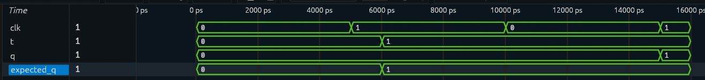

# T Flip-Flop

## Overview

A T Flip-Flop designed and verified using Verilog HDL.

The T Flip-Flop is a sequential logic element that stores one bit of data. Its next state depends on the value of the `T` input at the rising edge of the clock.

The two operating modes are:

```text
T = 0 → Hold
T = 1 → Toggle
```

## Block Diagram

```text
                 ┌─────────────────┐
T ──────────────▶│                 │─────▶ Q
                 │   T FLIP-FLOP   │
CLK ────────────▶│                 │
                 └─────────────────┘
```

## Truth Table

| Clock Edge | T | Q(next) | Operation |
|---|---:|---:|---|
| ↑ | 0 | Q | Hold |
| ↑ | 1 | Q̅ | Toggle |

### Input-to-Output Mapping

| T | Q(next) | Operation |
|---|---|---|
| 0 | Q | Hold previous state |
| 1 | Q̅ | Toggle previous state |

The output changes only on the rising edge of the clock.

## Characteristic Equation

The characteristic equation of a T Flip-Flop is:

```text
Q(next) = T ⊕ Q
```

When `T = 0`, the output remains unchanged.

When `T = 1`, the output toggles to its opposite state.

## RTL Implementation

The design is implemented using a positive-edge triggered sequential `always` block.

```verilog
module T_flipflop (
    input clk,
    input t,
    output reg q
);

initial begin
    q = 1'b0;
end

always @(posedge clk) begin
    case (t)
        1'b0: q <= q;    // Hold
        1'b1: q <= ~q;   // Toggle
    endcase
end

endmodule
```

The `posedge clk` ensures that the flip-flop responds only to the rising edge of the clock.

The initial value of `q` is set to `0` so that the testbench starts from a known state.

## Testbench

The testbench verifies the two functional modes of the T Flip-Flop.

The test sequence is:

```text
Initial Q = 0

Test 1:
T = 0 → Q remains 0

Test 2:
T = 1 → Q toggles from 0 to 1
```

A self-checking task compares the actual output `q` against the expected value `expected_q`.

```verilog
`timescale 1ns/1ps

module T_flipflop_tb;

    reg clk;
    reg t;
    reg expected_q;
    wire q;

    T_flipflop uut(
        .clk(clk),
        .t(t),
        .q(q)
    );

    // Clock generation
    always #5 clk = ~clk;

    // Waveform dumping
    initial begin
        $dumpfile("waveform.vcd");
        $dumpvars(0, T_flipflop_tb);
    end

    // Self-checking task
    task check_output;
        begin
            #1;

            if(q !== expected_q)
                $display("FAIL: Expected=%b | Actual=%b",
                         expected_q, q);
            else
                $display("PASS: Expected=%b | Actual=%b",
                         expected_q, q);
        end
    endtask

    // Test Sequence
    initial begin

        clk = 0;
        t = 0;
        expected_q = 0;

        // Test 1: Hold
        t = 0;
        expected_q = 0;

        @(posedge clk);
        check_output;

        // Test 2: Toggle
        t = 1;
        expected_q = 1;

        @(posedge clk);
        check_output;

        $display("--------------------------------------");
        $display("T FLIP-FLOP TEST COMPLETE");
        $display("--------------------------------------");

        $finish;

    end

endmodule
```

## Simulation

The RTL was simulated using Icarus Verilog and the generated VCD waveform was analyzed using Surfer.

### Simulation Waveform



The simulation sequence is:

```text
Initial Q = 0

Test 1: T = 0 → Q = 0  (Hold)
Test 2: T = 1 → Q = 1  (Toggle)
```

The simulation confirms that the T Flip-Flop holds its state when `T = 0` and toggles its state when `T = 1`.

### Waveform Timing Note

The `expected_q` signal changes when the testbench applies a new expected value, while the actual `q` output changes only on the rising edge of the clock.

Therefore, in the waveform, `expected_q` may change slightly before `q`. This is expected and does not indicate a timing error.

The testbench uses a `#1` delay inside `check_output` after `@(posedge clk)` to allow the non-blocking assignment in the DUT to update `q` before comparing the actual and expected values.

```text
T changes
   ↓
expected_q changes
   ↓
posedge clk
   ↓
q updates
   ↓
#1 delay
   ↓
q compared with expected_q
```

The waveform therefore correctly shows the testbench expectation changing before the clocked output transition.

## Verification

The two directed test cases verify both functional modes of the T Flip-Flop.

| Test | T | Previous Q | Expected Q | Observed Q | Result |
|---|---:|---:|---:|---:|---|
| 1 | 0 | 0 | 0 | 0 | PASS |
| 2 | 1 | 0 | 1 | 1 | PASS |

All test cases passed during simulation.

The simulation confirms that:

- `T = 0` holds the previous state.
- `T = 1` toggles the stored state.
- The output changes only on the rising edge of the clock.
- The self-checking testbench correctly compares expected and actual outputs.

## Project Structure

```text
T_FlipFlop/
│
├── T_flipflop.v
├── T_flipflop_tb.v
├── waveform.vcd
├── waveform.png
└── README.md
```

## Tools Used

- Verilog HDL
- Icarus Verilog — RTL simulation
- Surfer — waveform analysis

## Learning Outcomes

This project helped reinforce:

- Sequential logic design
- T Flip-Flop operation
- Hold and toggle modes
- Positive-edge triggered logic
- Clock-controlled state changes
- Verilog `always` blocks
- `case` statements
- Non-blocking assignments
- Self-checking testbench development
- VCD waveform generation
- RTL simulation and functional verification
- Waveform analysis using Surfer

## Next Project

**Registers**

The next project will build on flip-flop fundamentals and introduce registers for storing multiple bits of data.