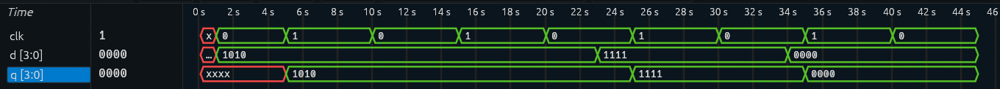

# 4-bit Register

A 4-bit register is a sequential logic circuit used to store a 4-bit binary value. It consists conceptually of four D flip-flops operating in parallel and sharing a common clock.

The register captures the value present at the input `D[3:0]` on the rising edge of the clock and holds that value until the next rising edge.

## Theory

### Working Principle

For a positive-edge-triggered register:

```text
At ↑CLK:
    Q ← D
```

If `D` changes while there is no rising edge of `CLK`, `Q` remains unchanged.

### Block Diagram

```text
             ┌──────────────────┐
D[3:0] ─────►│                  │─────► Q[3:0]
             │   4-bit Register │
CLK ────────►│                  │
             └──────────────────┘
```

### Truth Table

| Clock Event | D | Q |
|---|---|---|
| ↑CLK | 1010 | 1010 |
| No ↑CLK | 0110 | 1010 |
| ↑CLK | 0110 | 0110 |

The second row demonstrates that changing the input does not change the stored value until another rising clock edge occurs.

## RTL Implementation

The register is described using a positive-edge-triggered `always` block:

```verilog
always @(posedge clk) begin
    q <= d;
end
```

The non-blocking assignment `<=` is used for sequential logic.

## Verification

A self-checking testbench is used to automatically compare the actual output with the expected output.

Test cases include:

| Test | Input D | Expected Q |
|---|---|---|
| 1 | `1010` | `1010` |
| 2 | `1010` | `1010` |
| 3 | `1111` | `1111` |
| 4 | `0000` | `0000` |

The testbench reports `PASS` or `FAIL` for each test.

## Simulation

The design was simulated using Icarus Verilog and the waveform was inspected using Surfer.

### Compile

```bash
iverilog -o register_4bit.vvp register_4bit.v register_4bit_tb.v
```

### Run

```bash
vvp register_4bit.vvp
```

### View Waveform

```bash
surfer waveform.vcd
```

## Expected Verification Output

```text
PASS: Expected=1010 | Actual=1010
PASS: Expected=1010 | Actual=1010
PASS: Expected=1111 | Actual=1111
PASS: Expected=0000 | Actual=0000
```

## Waveform



The waveform demonstrates that `Q` updates only on the rising edge of `CLK` and retains its previous value between clock edges.

## Project Structure

```text
4bit_Register/
├── register_4bit.v
├── register_4bit_tb.v
├── waveform.vcd
├── waveform.png
└── README.md
```

## Key Concepts

- Sequential logic
- Positive-edge-triggered storage
- D flip-flops
- Registers
- Non-blocking assignments
- Clocked `always` blocks
- Self-checking testbenches
- Icarus Verilog simulation
- Waveform analysis