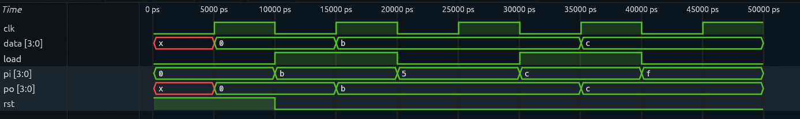

# 4-Bit Parallel-In Parallel-Out (PIPO) Register

## Overview

This project implements a **4-bit Parallel-In Parallel-Out (PIPO) register** using Verilog HDL.

The register captures four input bits simultaneously on the rising edge of the clock and makes all four bits available at the output simultaneously.

The design includes:
- Synchronous active-high reset.
- Parallel data loading.
- Load enable control.
- Data retention when loading is disabled.

## Design Specifications

| Parameter | Description |
|---|---|
| Design | 4-bit PIPO Register |
| HDL | Verilog |
| Data Width | 4 bits |
| Clock | Positive-edge triggered |
| Reset | Synchronous, active-high |
| Load Enable | Active-high |

## Input and Output Signals

| Signal | Direction | Width | Description |
|---|---|---|---|
| `clk` | Input | 1 bit | Clock signal |
| `rst` | Input | 1 bit | Synchronous reset |
| `load` | Input | 1 bit | Parallel load enable |
| `pi` | Input | 4 bits | Parallel input data |
| `po` | Output | 4 bits | Parallel output data |

## Working Principle

The register operates according to the following control logic:

1. **Reset:** When `rst = 1`, the register is cleared to `0000` at the rising clock edge.
2. **Parallel Load:** When `load = 1`, the four-bit input is captured simultaneously.
3. **Hold:** When `load = 0`, the register retains its previously stored value.

### Functional Behaviour

| Reset | Load | Operation |
|---|---|---|
| 1 | X | Clear register |
| 0 | 1 | Load parallel input |
| 0 | 0 | Hold previous data |

Reset has priority over the load signal.

## Project Structure

```text
4-bit-PIPO-Register/
│
├── pipo.v
├── tb_pipo.v
├── wave.vcd
└── README.md
```

## Simulation and Verification


The design was simulated using **Icarus Verilog** and its output waveforms were inspected using **GTKWave**.

### Test Scenarios

| Test | Reset | Load | Input | Expected Output |
|---|---|---|---|---|
| Reset | 1 | 0 | 0000 | 0000 |
| Parallel Load | 0 | 1 | 1011 | 1011 |
| Hold | 0 | 0 | 0101 | 1011 |
| Parallel Load | 0 | 1 | 1100 | 1100 |
| Hold | 0 | 0 | 1111 | 1100 |

### Simulation Commands

Compile the design and testbench:

```bash
iverilog -o pipo.out pipo.v tb_pipo.v
```

Run the simulation:

```bash
vvp pipo.out
```

Open the generated waveform:

```bash
gtkwave wave.vcd
```

## Simulation Results

The simulation waveform confirms the expected register behaviour:

- Reset clears the stored data.
- Parallel loading captures all four bits simultaneously.
- Disabling the load signal preserves the previously stored data.
- New parallel data is captured on subsequent rising clock edges.

The simulation was visually inspected using GTKWave.

## Future Improvements

- Implement an automated self-checking testbench.
- Add functional assertions.
- Introduce randomized test scenarios.
- Add automated regression and coverage analysis.

## Tools Used

- Verilog HDL
- Icarus Verilog
- GTKWave
- Visual Studio Code
- Git and GitHub

## Author

**Snehul Mistry**

Electronics and Communication Engineering

Parul University

---

*This project is part of a hands-on RTL design and verification portfolio focused on digital logic and sequential circuit design.*