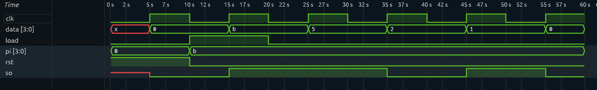

# 4-Bit PISO Shift Register (Verilog)

A 4-bit Parallel-In Serial-Out (PISO) shift register implemented using Verilog HDL and verified through simulation.

## Overview

A PISO shift register accepts 4-bit parallel data and transmits it serially, one bit per clock cycle.

This implementation uses:
- 4-bit parallel input
- 1-bit serial output
- Synchronous active-high reset
- Load control signal
- Right-shift operation
- LSB-first serial transmission

## Architecture

**Inputs:**
- `clk` — Clock signal
- `rst` — Synchronous active-high reset
- `load` — Parallel load enable
- `pi[3:0]` — 4-bit parallel input

**Output:**
- `so` — Serial output

## Working Principle

The register operates in three modes:

1. **Reset:** Clears the internal register to `0000`.
2. **Load:** Loads all four input bits simultaneously.
3. **Shift:** Shifts data right by one bit on every rising clock edge.

The least significant bit (`data[0]`) is connected to the serial output.

## Example

Parallel input: `1011`

Transmission order (LSB first):

`1 → 1 → 0 → 1`

| Operation | Internal Register | Serial Output |
|---|---|---|
| Reset | 0000 | 0 |
| Load | 1011 | 1 |
| Shift 1 | 0101 | 1 |
| Shift 2 | 0010 | 0 |
| Shift 3 | 0001 | 1 |
| Shift 4 | 0000 | 0 |

## Project Structure

```text
PISO/
├── piso.v
├── piso_tb.v
├── wave.vcd
└── README.md
```

## Simulation and Verification




The design was simulated using:

- Icarus Verilog
- GTKWave

The waveform was inspected to verify parallel loading, right shifting and serial data transmission.

**Simulation result:** Successful. The expected serial sequence `1101` was observed for parallel input `1011`.

## How to Run

Compile:

```bash
iverilog -o sim piso.v piso_tb.v
```

Run simulation:

```bash
vvp sim
```

Open waveform:

```bash
gtkwave wave.vcd
```

## Concepts Learned

- Parallel-to-serial data conversion
- Shift register architecture
- Clocked sequential logic
- Synchronous reset
- Load control and shifting
- Verilog testbench development
- RTL simulation and waveform analysis

## Tools and Technologies

- Verilog HDL
- Icarus Verilog
- GTKWave
- Visual Studio Code
- Windows 11

---

**Part of my RTL and Digital Design learning journey.**