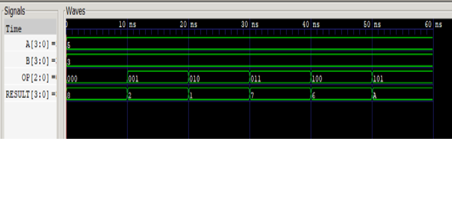

# 4-Bit ALU in Verilog

A simple **4-bit Arithmetic Logic Unit (ALU)** designed in **Verilog HDL** and verified using a custom **testbench**. The project was simulated with **Icarus Verilog** and analyzed using **GTKWave**.

---

## Features

- 4-bit operands (`A` and `B`)
- 3-bit operation selector (`OP`)
- Pure combinational logic (`always @(*)`)
- Functional verification using a Verilog testbench
- Waveform generation and analysis using GTKWave

---

## Supported Operations

| OP Code | Operation | Expression |
|:------:|-----------|------------|
| `000` | Addition | `A + B` |
| `001` | Subtraction | `A - B` |
| `010` | Bitwise AND | `A & B` |
| `011` | Bitwise OR | `A \| B` |
| `100` | Bitwise XOR | `A ^ B` |
| `101` | Bitwise NOT | `~A` |

---

## Project Structure

```text
ALU4BIT/
│
├── alu.v              # 4-bit ALU implementation
├── alu_tb.v           # Testbench
├── waveform.png       # GTKWave simulation screenshot
├── README.md
├── LICENSE
└── .gitignore
```

---

## Tools Used

- Verilog HDL
- Icarus Verilog
- GTKWave
- Visual Studio Code
- Git
- GitHub

---

## Simulation Workflow

### Compile

```bash
iverilog -o alu_sim alu.v alu_tb.v
```

### Run Simulation

```bash
vvp alu_sim
```

### View Waveform

```bash
gtkwave waveform.vcd
```

---

## Verification Results

The ALU was verified using the following test cases.

| Operation | Inputs | Expected Output | Simulation |
|-----------|--------|:---------------:|:----------:|
| ADD | 5 + 3 | 8 | ✅ |
| SUB | 5 − 3 | 2 | ✅ |
| AND | 0101 & 0011 | 0001 | ✅ |
| OR | 0101 \| 0011 | 0111 | ✅ |
| XOR | 0101 ^ 0011 | 0110 | ✅ |
| NOT | ~0101 | 1010 (Hex: A) | ✅ |

---

## Simulation Waveform

The waveform below verifies the functionality of all supported ALU operations.



---

## Learning Outcomes

Through this project, I learned:

- Verilog module design
- Input and output ports
- `always @(*)` blocks
- `case` statements
- Combinational circuit design
- Verilog testbench development
- Digital circuit simulation
- Waveform debugging using GTKWave
- Basic Git and GitHub workflow for hardware projects

---

## Future Improvements

- Carry flag
- Overflow flag
- Zero flag
- Negative flag
- Parameterized ALU width (8-bit, 16-bit, 32-bit)
- Shift and Rotate operations
- Multiplication and Division
- FPGA implementation using Xilinx Vivado

---

## Author

**Snehul Mistry**

GitHub: https://github.com/snehulmistry

---

